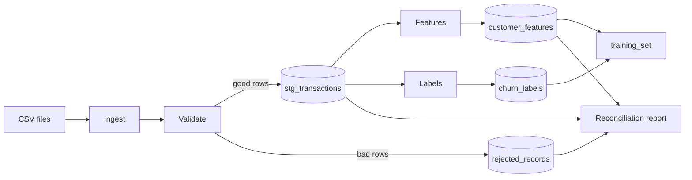

# Point-in-Time ML Feature Pipeline


A pipeline that turns raw **transaction data** into **ML features** for a churn model.
It prevents target leakage, makes reruns safe, and uses the same feature logic for training and inference.
It runs fully locally: no server, no cloud, no secrets.

---

## Deliverables: where to find them

| Asked for | Where |
|---|---|
| Source code + setup files | [src/](src/), [requirements.txt](requirements.txt), [config.yaml](config.yaml) |
| Sample data + generator | [data/sample/](data/sample/), [src/generate_data.py](src/generate_data.py) |
| Expected answers (kept separate from input) | [data/labels/expected_rejects.csv](data/labels/expected_rejects.csv) |
| Automated tests + execution evidence | [tests/](tests/), [output/test_results.txt](output/test_results.txt) |
| Output dataset | [output/customer_features.csv](output/customer_features.csv), [output/training_set.csv](output/training_set.csv) |
| Reconciliation results | [output/reconciliation_report.md](output/reconciliation_report.md) |
| Sample queries + results | [sql/sample_queries.sql](sql/sample_queries.sql), [output/sample_query_results.md](output/sample_query_results.md) |
| Schema / data dictionary | [data_dictionary.md](data_dictionary.md) |
| Design + trade-off note | [docs/design_notes.md](docs/design_notes.md) |

---

## Tech stack

| Tool | Used for |
|---|---|
| **Python 3.10+** | Runs every step of the pipeline |
| **csv module** | Reads raw files line by line, keeping line numbers and catching broken rows |
| **pandas** | Checks all rows of a file against each validation rule |
| **DuckDB** | Local database file that stores all tables and runs the SQL (no server needed) |
| **SQL** | Feature, label and reconciliation logic |
| **PyYAML** | Reads settings from `config.yaml` |
| **pytest** | 40 automated tests |
| **logging** | Console output plus a log file for each run |

---

## Setup and run

Requires Python 3.10+. Tested on Windows 11 with Python 3.13.

```bash
python -m venv .venv
.venv\Scripts\activate              # Windows  (macOS/Linux: source .venv/bin/activate)
pip install -r requirements.txt

python -m src.generate_data --rows 5000 --seed 42      # 1. create sample data
python -m src.run_pipeline                             # 2. run pipeline (training)
python -m src.run_pipeline                             # 3. run again: no duplicates
python -m src.run_pipeline --mode inference --as-of 2026-05-01   # 4. inference
python -m src.show_results                             # 5. sample queries
pytest -v                                              # 6. tests
```

| Flag | Meaning |
|---|---|
| `--force` | Reprocess every file, even if already loaded |
| `--input-dir`, `--db-path`, `--output-dir` | Override paths from `config.yaml` |

Exit codes: `0` = OK, `1` = run failed, `2` = reconciliation failed.

---

## Architecture



1. **Ingest**: read `customers.csv` and each weekly `transactions_*.csv` as text, with line numbers.
2. **Validate**: check every row. Good rows are saved, and bad rows go to the reject table with a reason.
3. **Transform**: compute features for each customer at each snapshot date (`as_of_date`).
4. **Labels**: did the customer stop buying in the next 30 days? (stored separately)
5. **Publish and verify**: save the tables, run the reconciliation checks, write the reports and the run log.

---

## Source data

| Entity | Key | Grain | Relationship |
|---|---|---|---|
| `customers.csv` | `customer_id` (unique) | one row per customer | 1 customer has many transactions |
| `transactions_*.csv` | `transaction_id` (unique across all files) | one row per transaction event | `customer_id` must exist in customers |

Transaction columns: `transaction_id, customer_id, txn_ts, ingested_at, amount, txn_type, merchant_category`, all required.
`txn_ts` is when the event happened and `ingested_at` is when we received it.
Full types, nullability and derived fields are in [data_dictionary.md](data_dictionary.md).

---

## Key rules

### Point-in-time (no target leakage)
For a snapshot date **D**, a transaction is used only if:
- it **happened** before D (`txn_ts < D`), **and**
- it **arrived** before D (`ingested_at < D`). This blocks late data we didn't have yet.

Also:
- a customer counts only if `signup_date < D`
- labels look **forward**, `[D, D+30 days)`, and live in a separate table
- a label is built only once the full 30 days of data exist

### Training = inference
All features are defined in **one SQL query** ([src/features.py](src/features.py)).
Training and inference call the same function, and a test checks they return identical values.

### Idempotency, retry, restart, backfill
- **Rerun same input**: each file's hash is saved, so unchanged files are skipped and nothing is duplicated.
- **All-or-nothing load**: each file is loaded in one DB transaction (delete its old rows, then insert the new ones).
- **Crash mid-run**: the failed file is rolled back, so you just rerun. The final result equals a clean run.
- **Corrected file** (same name, new content): it replaces its old rows.
- **Backfill**: add dates to `as_of_dates` in `config.yaml` and rerun. Only those dates are rebuilt.
- **Late data**: it is loaded, but past snapshots still ignore it, so old training data stays reproducible.

### Reject and quarantine
- A bad row is saved to `rejected_records` with its **file, line number, reason and raw values**.
- A file with a **missing column** is quarantined as a whole, and the run status becomes `PARTIAL_SUCCESS`.
- Extra or reordered columns are OK, they are just logged.
- Duplicates: the **first one seen wins**, and later copies are rejected.

Checks: missing fields, bad dates and amounts, bad categories, unknown customer, transaction before signup,
arrival before the event happened, duplicates, malformed rows, schema change.
Full list of reason codes: [data_dictionary.md](data_dictionary.md#reject-reason-codes)

---

## Output tables

Stored in `output/feature_store.duckdb` and also exported as CSV to `output/`.

| Table | One row = | Purpose |
|---|---|---|
| `customers` | a customer | valid customers |
| `stg_transactions` | a transaction | clean, deduplicated transactions |
| `rejected_records` | a bad row or file | quarantine with the reason |
| `processed_files` | a file | hash and status, used for skipping on rerun |
| `customer_features` | customer + date | **ML features** |
| `churn_labels` | customer + date | target (kept separate) |
| `training_set` (view) | customer + date | features + label |
| `pipeline_runs` | a run | run log |

**Features:** `tenure_days`, `purchase_count_7d/30d/90d`, `purchase_amount_30d`,
`avg_purchase_amount_30d`, `max_purchase_amount_90d`, `refund_count_90d`,
`distinct_categories_30d`, `days_since_last_purchase`.

---

## Logging and metrics

Every run adds a row to `pipeline_runs` with:
- `run_id` and status (`SUCCESS` / `PARTIAL_SUCCESS` / `FAILED`)
- start time, end time and duration
- input, loaded and rejected rows
- files skipped and quarantined
- time per stage
- failure reason (`error_message`)

There is also a log file per run in `output/logs/`.

---

## Sample data

`generate_data.py` creates **5,000 transactions** (fixed seed, so the same files every time) in **20 weekly files**:

| Normal | Edge cases | Deliberately bad |
|---|---|---|
| 4,785 valid rows | boundary amounts (`0.01`, `100000`) | 60 duplicates |
| out-of-order rows | transaction exactly at the snapshot time | blank fields, bad dates and amounts |
| ~5% late arrivals | transaction exactly at signup | unknown customers |
| | empty file | transactions before signup |
| | | malformed rows |
| | | 1 file with a changed schema |

The list of bad rows (the **answer key**) is kept separately in `data/labels/expected_rejects.csv`,
never inside the input files.

---

## Reconciliation

Each run writes `output/reconciliation_report.md`. The raw files are re-read independently and the results compared:

- source rows = loaded + rejected
- source amount total = loaded total + rejected total
- no duplicate keys in any table
- every transaction has a valid customer
- one feature row per eligible customer per date
- feature totals match a separate point-in-time query
- rejects match the answer key exactly

**Result on the sample: all 12 checks PASS** (199 expected rejects = 199 actual).

---

## Tests

`pytest -v` runs **40 tests, all passing**. Evidence: [output/test_results.txt](output/test_results.txt).

| Required case | Covered |
|---|---|
| happy path | yes |
| empty input (header-only and 0-byte files) | yes |
| malformed records | yes |
| missing required fields / nulls | yes |
| duplicate key / event | yes |
| unexpected schema change | yes |
| invalid reference key | yes |
| partial failure and retry | yes |
| late-arriving / out-of-order data | yes |
| rerun of the same input | yes |
| domain-specific edge cases | no leakage, snapshot boundary, signup rules, label window, train = inference |

Mapping of each test to its requirement: [docs/design_notes.md](docs/design_notes.md#test-coverage)

---

## Performance

| Run | Rows | Time |
|---|---|---|
| First run | 5,000 | ~1.3 s |
| Rerun (all skipped) | 0 | ~0.2 s |
| Large run | 100,000 | to be measured |

Generate the large dataset with:
`python -m src.generate_data --rows 100000 --out data/large --labels-dir data/large_labels`

**Bottleneck:** loading transactions (~55 ms per file). For each file, every already-loaded ID
is pulled into Python for the duplicate check.
**Optimization:** do that duplicate check inside DuckDB (anti-join) instead.

---

## Naming conventions

- `snake_case` for all tables and columns. Staging tables start with `stg_`.
- Timestamps are ISO-8601 UTC (`2026-02-25T10:00:00Z`). Dates are `YYYY-MM-DD`.
- `transaction_id` and `customer_id` come from the source. `reject_id` = hash of file + line (the same on every rerun).
- `run_id` = `run_<UTC time>_<random>`. Every row stores `run_id`, `source_file` and `source_line_number`.

---

## Design choices (short)

- **DuckDB instead of Spark/Postgres**: runs locally with no server, and is fast enough for 100K+ rows.
- **Two timestamps** (`txn_ts` + `ingested_at`): stops late data leaking into past snapshots.
- **One feature query**: prevents differences between training and inference.
- **Per-file replace + hash**: makes reruns and retries safe.
- **Keys checked by reconciliation**, not DB constraints: simpler, and verified on every run.

Full reasoning and trade-offs: [docs/design_notes.md](docs/design_notes.md)

---

## Project structure

```
├── config.yaml            settings (paths, dates, rules)
├── src/
│   ├── generate_data.py   sample data + answer key
│   ├── config.py          reads config.yaml
│   ├── schemas.py         columns, reject codes, tables
│   ├── ingest.py          reads CSV files
│   ├── validate.py        row checks
│   ├── features.py        features + labels (SQL)
│   ├── publish.py         database writes
│   ├── reconcile.py       correctness checks
│   ├── run_pipeline.py    main entry point
│   └── show_results.py    sample queries
├── sql/sample_queries.sql
├── tests/                 40 tests
├── data/sample/           input data
├── data/labels/           answer key
├── output/                results, reports
├── data_dictionary.md     tables + columns
└── docs/design_notes.md   design choices + trade-offs
```

---

## Assumptions

- Transactions are **events that never change**. A second copy is a duplicate, and corrections come as refunds.
- Amounts are positive and in a single currency.
- Files arrive in name order (weekly).
- `customers.csv` is a full snapshot. If it's missing or broken, the run stops.
- Snapshots are taken at midnight UTC.

## Known limitations

- Customers have no change history (they are a snapshot).
- Rows from a source file that is deleted later are not removed.
- A very late arrival after a label is built could change that label.
- DuckDB allows only one writer, so don't run two pipelines at once.

## Next steps

- Run and profile 100K rows, then apply the optimization above.
- Keep customer history (SCD-2).
- Export features as Parquet.
- Schedule runs (cron / Airflow) and alert on failures.
