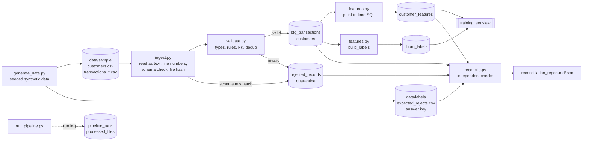

# Point-in-Time ML Feature Pipeline


A small, reproducible pipeline that turns raw **transaction data** into **ML features** for a
customer-churn model. It **prevents target leakage**, follows clear **point-in-time rules**, and
uses **one feature definition for both training and inference**.

> **AI usage:** this project was built with the help of Claude Code. See [AI_USAGE.md](AI_USAGE.md)
> for what AI did and what I did.

Everything runs locally with Python and DuckDB (a database stored in a single file). There are no servers, no cloud services and no credentials.

---

## 🚀 1. Quick start

```bash
# 1. setup (Python 3.10+)
python -m venv .venv
.venv\Scripts\activate            # Windows
# source .venv/bin/activate       # macOS / Linux
pip install -r requirements.txt

# 2. generate the 5,000-row sample (fixed seed, so the files are identical every time)
python -m src.generate_data --rows 5000 --seed 42

# 3. run the pipeline (training mode: features + labels for the as_of_dates in config)
python -m src.run_pipeline

# 4. run it again: all files are skipped and nothing is duplicated
python -m src.run_pipeline

# 5. inference: same feature code, one snapshot date, no labels
python -m src.run_pipeline --mode inference --as-of 2026-05-01

# 6. look at the results
python -m src.show_results        # runs sql/sample_queries.sql
pytest -v                         # 40 automated tests
```

Exit codes: `0` success (including partial success), `1` run failed, `2` reconciliation failed.

Useful flags:
- `--input-dir`, `--db-path`, `--output-dir`, `--expected-rejects`: override paths from `config.yaml`
- `--force`: reprocess every file
- `--config`: use a different config file

---

## 🛠️ Tech stack

| Tool | Used for |
|---|---|
| **Python** | Runs every step of the pipeline |
| **csv module** | Reads raw files line by line, keeping line numbers and catching broken rows |
| **pandas** | Checks all rows of a file against each validation rule |
| **DuckDB** | Database file that stores all tables and runs the SQL |
| **SQL** | Feature, label and reconciliation logic |
| **PyYAML** | Reads settings from `config.yaml` |
| **pytest** | Automated tests |
| **logging** | Console output plus a log file for each run |

---

## 🎯 2. What problem it solves

The model predicts: **"will this customer make no purchase in the next 30 days?"** at a
snapshot date (`as_of_date`). For every `(customer_id, as_of_date)` the pipeline builds
features such as purchases in the last 7/30/90 days, spend, refunds and days since the last purchase.

The main risk is **target leakage**: using information from on or after the snapshot date
by mistake. The model then looks great in testing and fails in production.

### Point-in-time rules

For a feature row at `as_of_date = D`:

| Rule | Why |
|---|---|
| use a transaction only if `txn_ts < D 00:00:00 UTC` | no future events |
| **and** only if `ingested_at < D 00:00:00 UTC` | no *late-arriving* data we didn't actually have at time D |
| include a customer only if `signup_date < D` | the customer must exist at time D |
| labels look at `[D, D + 30 days)` and live in a **separate table** | features never read labels |
| build a label only if data covers the whole window (`max(txn_ts) >= D + 30d`) | no half-observed labels |

All features are defined in **one SQL query** in [src/features.py](src/features.py).
`--mode train` and `--mode inference` both call the same `build_features()` function. A test
checks that both return identical values.

---

## 🏗️ 3. Architecture



**What happens in one run** ([src/run_pipeline.py](src/run_pipeline.py)):

1. **Customers**: read `customers.csv`, validate it, and replace the `customers` table (full snapshot).
2. **Transactions**: for each `transactions_*.csv`, in sorted order:
   - skip the file if `processed_files` already has the same name and the same SHA-256 hash (safe rerun)
   - check the header: missing columns mean the whole file is **quarantined**, while extra or reordered columns are fine
   - validate the rows, then **in one DB transaction** delete that file's old rows and insert the new valid rows, rejects and file status
3. **Features**: build them for every configured `as_of_date` (or the single `--as-of` date in inference mode). Old rows for those dates are replaced.
4. **Labels** (train mode only): build them for dates whose 30-day future window is fully covered by data.
5. **Reconciliation**, then CSV exports and a row in `pipeline_runs`.

### Storage: DuckDB tables (`output/feature_store.duckdb`)

| Table | Grain / key | Purpose |
|---|---|---|
| `customers` | `customer_id` | valid customer snapshot |
| `stg_transactions` | `transaction_id` | valid, deduplicated, typed transactions (append-only events) |
| `rejected_records` | `reject_id` (hash of entity + file + line) | every rejected record or file, with reason and raw values |
| `processed_files` | `source_file` | file hash and status (LOADED / EMPTY / QUARANTINED), used for skip and retry |
| `customer_features` | `(customer_id, as_of_date)` | **ML features** |
| `churn_labels` | `(customer_id, as_of_date)` | **target**, kept separate |
| `training_set` (view) | `(customer_id, as_of_date)` | features joined with labels |
| `pipeline_runs` | `run_id` | run status, timings, counts, error |

Every column is described in [data_dictionary.md](data_dictionary.md).

---

## 📂 4. Project structure

```
├── README.md                 this file
├── data_dictionary.md        every table and column
├── AI_USAGE.md               how AI was used, and what I reviewed and validated
├── docs/design_notes.md      design choices and trade-offs
├── config.yaml               paths, as_of_dates, label window, validation limits
├── requirements.txt / pytest.ini
├── src/
│   ├── generate_data.py      synthetic data + answer key (seeded)
│   ├── config.py             loads config
│   ├── schemas.py            source schemas, reject codes, table definitions
│   ├── ingest.py             reads CSVs, line numbers, schema check, hashing
│   ├── validate.py           validation rules -> (valid, rejects)
│   ├── features.py           point-in-time features + labels (one definition)
│   ├── publish.py            safe, all-or-nothing database writes; run log
│   ├── reconcile.py          independent reconciliation checks + report
│   ├── run_pipeline.py       command line / runs all steps
│   └── show_results.py       runs sql/sample_queries.sql
├── sql/sample_queries.sql
├── tests/                    pytest suite (40 tests)
├── data/sample/              INPUT: customers.csv + 20 transaction files (5,000 rows)
├── data/labels/              ANSWER KEY (kept separate): expected_rejects.csv, manifest
└── output/                   feature store, CSV exports, reports, logs
```

---

## 🧪 5. Sample data

`python -m src.generate_data --rows 5000 --seed 42` writes **exactly 5,000 transaction rows**
across weekly delivery files. Rows are grouped by `ingested_at` and shuffled inside each file, so
the data arrives out of order. It contains:

| Kind | Count (5k) | Expected result |
|---|---|---|
| normal valid transactions | 4,785 | loaded |
| boundary values: amount `0.01` and `100000.00`, txn exactly at `2026-03-01T00:00:00Z`, txn received exactly at the snapshot, txn exactly at signup | 5 | loaded (and left out of that snapshot where relevant) |
| late arrivals (received 2–10 days after the event) | ~5% | loaded with `is_late = true`, hidden from snapshots taken before they arrived |
| exact duplicates (in the same file and re-sent in a later file) | 60 | `duplicate_transaction_id` |
| blank required fields | 25 | `missing_required_field` |
| bad timestamp / amount / out of range / type / category | 15 / 10 / 15 / 10 / 10 | specific codes |
| received before the event happened | 10 | `ingested_before_event` |
| unknown customer (invalid reference key) | 20 | `unknown_customer_id` |
| transaction before customer signup | 10 | `txn_before_signup` |
| malformed rows (wrong number of fields) | 10 | `malformed_row` |
| schema change file (`amount` renamed to `amount_usd`) | 1 file, 20 rows | file `QUARANTINED` |
| empty batch (header only) | 1 file | `EMPTY`, no error |
| bad customer rows (duplicate, bad date, blank id) | 3 | customer rejects |

The input files have **no "is_bad" flag**. The generator writes the expected result to
`data/labels/expected_rejects.csv`, and reconciliation compares it with the real rejects
(**199 expected = 199 actual, 0 missing, 0 unexpected**).

---

## 🚫 6. Data quality and reject path

Rules run in a fixed order, and a record gets the **first** reason that fails. This keeps the result deterministic.

| Code | Rule |
|---|---|
| `malformed_row` | row has a different number of fields than the header |
| `missing_required_field` | a required column is blank (the detail says which one) |
| `invalid_timestamp` / `invalid_date` | not ISO-8601 (`YYYY-MM-DDTHH:MM:SSZ`) / not `YYYY-MM-DD` |
| `invalid_amount` | not a number (e.g. `12,50`, `$40`) |
| `amount_out_of_range` | must be `> 0` and `<= 100000` (configurable) |
| `invalid_txn_type` | not `purchase` or `refund` (case-sensitive) |
| `invalid_merchant_category` | not in the allowed list |
| `ingested_before_event` | `ingested_at < txn_ts` (impossible) |
| `unknown_customer_id` | customer not in the valid customers (referential integrity) |
| `txn_before_signup` | `txn_ts < signup_date` |
| `duplicate_transaction_id` / `duplicate_customer_id` | key already seen. **First seen wins** (earlier file, then lower line). A broken first copy does not block a good later copy. |
| `schema_mismatch` | file is missing required columns, so the **whole file** is quarantined |

Every reject stores `source_file`, `source_line_number`, `raw_record` (the original values as JSON),
`run_id`, the reason and a detail, so you can trace it back to the exact line.

---

## ♻️ 7. Idempotency, retry, restart, backfill

| Scenario | What happens |
|---|---|
| **rerun the same input** | every file is skipped (same name + hash), so the tables don't change |
| **`--force` rerun** | each file's old rows are deleted and reloaded in one transaction: same result, no duplicates |
| **crash mid-run** | files already committed stay saved. The failing file is **rolled back completely**, so nothing is half-loaded. The run is logged as `FAILED` with the error. |
| **retry after a crash** | just run again: committed files are skipped and the rest are processed. The final state equals a clean run (tested). |
| **corrected file re-sent** (same name, new content) | the hash changes, so that file is replaced (old rows and rejects removed first) |
| **quarantined file** | stays quarantined, and every run reports `PARTIAL_SUCCESS` until a fixed file (new hash) arrives |
| **backfill new snapshot dates** | add dates to `features.as_of_dates` (or use `--mode inference --as-of D`) and rerun. Only those dates are replaced. |
| **late data arrives** | it gets loaded, but past snapshots still ignore it (because `ingested_at >= D`), so old training rows stay reproducible |

---

## 📈 8. Logging and monitoring

- **`pipeline_runs`**: one row per run, with:
  - `run_id`, `mode` and `status` (`RUNNING / SUCCESS / PARTIAL_SUCCESS / FAILED`)
  - start and end time, duration
  - files seen / processed / skipped / quarantined
  - input, loaded and rejected rows; feature and label rows
  - reconciliation status, time per stage (JSON) and `error_message`
- **`processed_files`**: status and counts per file.
- **Logs**: console plus `output/logs/<run_id>.log`, with per-file counts, late-row counts,
  quarantine errors and skipped label dates.
- **Exports** in `output/`: `customer_features.csv`, `training_set.csv`, `rejected_records.csv`,
  `processed_files.csv`, `pipeline_runs.csv`, `inference_features_<date>.csv`, `sample_query_results.md`.

---

## ✅ 9. Reconciliation (proof of correctness)

`output/reconciliation_report.md` is written on every training run. The source-side numbers come
from **re-reading the raw files with plain Python**, not from the pipeline's own code:

| Check | Meaning |
|---|---|
| row counts | per file: source rows = loaded + rejected (rows in quarantined files are reported separately) |
| customer rows | source rows = loaded + rejected |
| amount total | sum(amount) in source = loaded sum + rejected sum |
| primary keys | no duplicates in `stg_transactions`, `customers`, `customer_features` or `churn_labels` |
| referential integrity | every loaded transaction has a customer |
| coverage | exactly one feature row per eligible customer per snapshot |
| point-in-time recount | per snapshot, feature totals equal a separate "strictly before D" count |
| traceability | every reject has a file, line and reason |
| answer key | rejects equal `data/labels/expected_rejects.csv` exactly |

Current sample result: **all 12 checks PASS** (see [output/reconciliation_report.md](output/reconciliation_report.md)).

---

## 🧪 10. Tests

`pytest -v` runs 40 tests in about 12 s. Each test builds its own tiny input in a temp folder,
so you can check the expected values by hand.

| Requirement | Test(s) |
|---|---|
| happy path | `test_happy_path_loads_everything`, `test_feature_values_are_exact` |
| empty input | `test_empty_batch_header_only`, `test_no_transaction_files_and_zero_byte_file` |
| malformed records | `test_malformed_rows_are_rejected_with_line_numbers` |
| missing required field / nulls | `test_missing_required_fields_and_nullable_columns`, `test_bad_customer_rows` |
| bad values (12 cases) | `test_invalid_values_are_rejected[...]`, `test_amount_boundaries_are_accepted` |
| duplicate key / event | `test_duplicates_within_and_across_files`, `test_invalid_first_copy_does_not_block_valid_second_copy` |
| invalid reference key | `test_invalid_values_are_rejected[override11-unknown_customer_id]` |
| unexpected schema change | `test_schema_change_missing_column_quarantines_file`, `test_schema_change_extra_and_reordered_columns_still_load` |
| rerun same input | `test_rerun_same_input_creates_no_duplicates` |
| partial failure + retry | `test_partial_failure_then_retry_matches_clean_run` |
| corrected file | `test_corrected_file_replaces_previous_version` |
| late / out-of-order data | `test_late_arriving_txn_is_invisible_until_it_was_ingested` |
| **domain: no target leakage** | `test_no_target_leakage_future_data_does_not_change_features` |
| **domain: snapshot boundary** | `test_txn_exactly_at_as_of_is_excluded` |
| **domain: signup rules** | `test_signup_rules` |
| **domain: labels & incomplete windows** | `test_labels_look_forward_and_skip_immature_windows` |
| **train/inference consistency** | `test_training_and_inference_produce_identical_features` |
| logging | `test_run_log_records_metrics`, `test_missing_customers_file_fails_run_with_reason` |
| reconciliation catches errors | `test_reconciliation_detects_duplicate_keys[...]` |
| reproducibility | `test_same_seed_same_files`, `test_end_to_end_on_generated_data_matches_answer_key` |

Test output is saved in [output/test_results.txt](output/test_results.txt).

---

## ⚡ 11. Performance

Measured on a Windows laptop with Python 3.13 and DuckDB 1.1.3. Stage timings are stored in `pipeline_runs.stage_timings`.

| Dataset | Rows | Files | Total | Customers | Transactions | Features + labels | Reconciliation |
|---|---|---|---|---|---|---|---|
| sample | 5,000 | 20 | 1.31 s | 0.05 s | 1.13 s | 0.05 s | 0.06 s |
| rerun (all skipped) | 0 | 20 | 0.23 s | — | 0.02 s | 0.06 s | 0.05 s |
| large | 100,000 | 21 | 4.29 s | 0.12 s | 3.45 s | 0.33 s | 0.34 s |
| large rerun (all skipped) | 0 | 21 | 0.67 s | 0.07 s | 0.02 s | 0.22 s | 0.32 s |

The 100K run: 95,700 loaded, 4,300 rejected, 16,221 feature rows, all 12 reconciliation checks PASS
(3,904 expected rejects = 3,904 actual). 20× more data took only about 3× longer.

The dataset size is configurable. To reproduce the larger run:
`python -m src.generate_data --rows 100000 --out data/large --labels-dir data/large_labels`
then `python -m src.run_pipeline --input-dir data/large --db-path output/large/large.duckdb --output-dir output/large --expected-rejects data/large_labels/expected_rejects.csv`.

Loading transactions takes most of the time, about 55 ms per file. Most of that is per-file work:
reading the file, fetching all already-loaded IDs for the duplicate check, and moving DataFrames
into DuckDB. The feature SQL itself is fast because DuckDB is a columnar database.

**One optimization:** instead of loading every existing ID into
Python for each file, do the cross-file duplicate check inside DuckDB with an anti-join against
`stg_transactions`. The cost then depends on the size of the file, not on all the data loaded so far.

---

## 🏷️ 12. Naming conventions

* Tables and columns use `snake_case`. Staging tables use the `stg_` prefix.
* Timestamps are ISO-8601 UTC in the source (`2026-02-25T10:00:00Z`) and stored as UTC `TIMESTAMP`. Dates are `YYYY-MM-DD`.
* IDs are stable and deterministic:
  - `transaction_id` and `customer_id` come from the source
  - `reject_id = sha1(entity|source_file|line)[:16]`, so a bad line always gets the same ID across reruns
  - the feature key is `(customer_id, as_of_date)`
* `run_id = run_<UTC start>_<6 hex>`: unique per run and stored on every row written.
* `source_file` is the file name only (no machine path). `source_line_number` is the physical line in the file (header = 1).

---

## 📌 13. Assumptions

* Transactions are **events that never change**. A re-sent transaction is a duplicate, not an update. Corrections come as `refund` events.
* `amount` is positive and in a single currency. Refunds are also positive and are identified by `txn_type`.
* Source files arrive in name order (weekly, by ingestion date). "First seen" means first in that order.
* `customers.csv` is a full snapshot each run. A broken customers file stops the run, because transactions can't be checked without it.
* Feature snapshots are taken at midnight UTC.

---

## ⚠️ 14. Known limitations

* Customers are a snapshot, with no history (no SCD-2). If a customer row changes, old features are not re-versioned.
* If a source file is **deleted** from the input folder, its rows stay loaded.
* Label completeness uses `max(txn_ts)`, so data arriving very late after that could still change a label.
* DuckDB allows only one writer at a time, so don't run two pipelines at once.
* Primary keys are enforced by pipeline logic plus reconciliation checks, not by database constraints (see design notes).

---

## 🔭 15. Next steps

* Apply the anti-join optimization for larger datasets.
* Keep customer history (SCD-2) and track feature versions, with backfill by version.
* Export features as Parquet, split by `as_of_date`, for the ML team.
* Schedule runs (cron or Airflow) and alert on `FAILED` / `PARTIAL_SUCCESS` runs.
* Add data-quality thresholds (for example, fail the run if more than 5% of a file is rejected).
